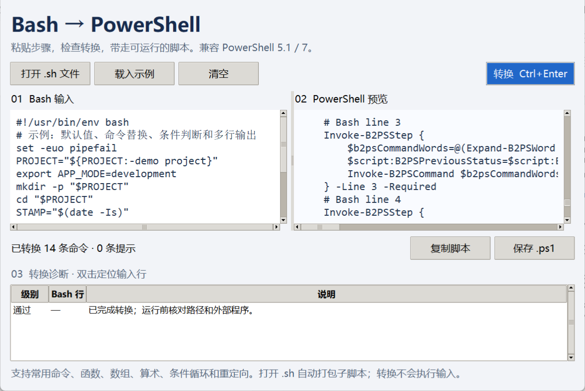

# bash2ps1 — Bash → 原生 PowerShell

**将常见 Bash 自动化脚本转换为 Windows PowerShell 5.1 / PowerShell 7 脚本。**

本地桌面工具，支持文件导入、粘贴、预览、诊断定位、复制及保存。输出不调用 Bash/WSL；转换时不联网、不执行输入。版本 **1.0.0** 完成了输出语义修正、常用语法/命令覆盖和 Bash 对照验证三个核心阶段。



## 使用

需要 Python 3.10+ 和 Tkinter，无第三方 Python 运行依赖。

1. 双击 `Launch.cmd`，或者运行 `python app.py`。
2. 选择“打开 .sh 文件”，或粘贴命令。涉及子脚本时应打开原文件。
3. 点击“转换”（Ctrl+Enter），查看诊断；双击诊断定位输入行。
4. 复制或保存 `.ps1`。输入变化后需要重新转换。

```powershell
python app.py examples/setup.sh -o converted.ps1
powershell -NoProfile -ExecutionPolicy Bypass -File .\converted.ps1
# 也可使用 pwsh -File .\converted.ps1
```

保存使用 UTF-8 BOM，保证 PowerShell 5.1 正确读取中文。生成脚本自动返回最终 Bash 状态，适用于命令行/CI；显式 `exit`、`return`、失败分支和 `set -e` 保留控制流。建议用独立脚本调用，不要用 dot-source 将完整输出脚本导入交互会话。

## 支持的常用语法

| 范围 | 支持内容 |
| --- | --- |
| 参数与字符串 | 单/双引号、转义、ANSI-C 引号、续行、注释、分号、空参数、Unicode |
| 变量 | 普通赋值、`+=`、`export`、`unset`、`local`、临时 `NAME=value command` |
| 展开 | `$NAME`、`${NAME}`、默认值/替代值/赋默认值/必填检查、长度、常量切片、前后缀删除、替换、大小写、普通间接变量 |
| 参数展开 | `$0`、位置参数、`$#`、`$?`、`$$`、`$@/$*`、`shift`、`set --`；引号保留参数边界 |
| 数组 | 索引数组、常见关联数组赋值、元素取值、追加、全部元素/键、数组长度 |
| 字段与文件展开 | `IFS` 字段拆分、通配符、花括号列表/范围、`~`；支持 `shopt` 的 nullglob/failglob |
| 控制流 | `if/elif/else`、`while/until`、列表/C 风格 `for`、`case` 的 `;;` 分支、`&&/||/!`、组合命令及子 Shell |
| 函数 | 两种常见定义写法、参数、局部变量、返回值、break/continue |
| 算术 | 整数、变量、四则/取模、比较、位运算、赋值、自增/自减、三元及短路运算 |
| 输入输出 | `$()`/反引号、`>`/`>>`/`<`、标准错误重定向与合并、here-document/here-string、`/dev/null` |
| 状态 | `set -e/-u/-a/-x`、对应关闭选项、`pipefail`、`PIPESTATUS` |
| 文件入口 | 静态 `.sh/.bash` 依赖递归打包；`source` 共享变量、`bash child.sh` 隔离环境和目录 |

命令替换保留无换行片段的拼接，仅去掉末尾 LF。输出和重定向不自动添加换行；外部程序的输入、二进制输出与错误流通过原始字节传递。Windows 上错误流合并使用同一系统管道，保留写入顺序。

## 支持的常用命令

| 类别 | 命令及主要选项 |
| --- | --- |
| 文件/目录 | `cd/pwd/pushd/popd`、`mkdir -p`、`touch`、`rmdir`、`cp -r/-R/-a/-f`、`mv -f`、`rm -r/-f`、`ln -s/-f` |
| 文本输出 | `echo -n/-e/-E`；`printf` 的常见字符串、整数、浮点、进制、宽度、精度及 `%b`/转义、`-v` |
| 读取/匹配 | `cat -n/-b/-s/-v/-A/-E/-T`；`grep -F/-E/-i/-v/-n/-c/-q/-o/-w/-x/-l/-L/-r/-m/-e/-f/-A/-B/-C` |
| 选择/统计 | `head/tail -n/-c`（含负数 head、从第 N 行 tail）；`wc -l/-w/-m/-c`，按实际 LF/字节计数 |
| 排序/字段 | `sort -r/-n/-f/-u/-s/-k/-t/-o`、`uniq -c/-d/-u/-i`、`cut -f/-b/-c/-d/-s`、`tr -d/-s/-c` 和常见字节字符集 |
| 常见文本程序 | `sed` 的 s 替换、地址 d/p/q、`-n/-E/-e/-i`；`awk` 的字段打印、NR/NF、简单列求和 |
| 组合/辅助 | `tee -a`、`xargs -0/-n/-I/-r/-d`、`read -r/-a/-p`、`seq`、`sleep`、ISO/常见格式 `date`、`dirname/basename/realpath` |
| 路径/环境 | `find -mindepth/-maxdepth/-type/-name/-iname/-print/-print0`、`env`、`printenv`、程序路径查询 |
| 外部程序 | `git/python/pip/node/npm/docker/uv/curl/tar/ssh` 等调用已安装的 Windows 可执行程序；python3/pip3 映射为 python/pip |

`sed/awk` 支持表中的常见程序，不是这两种语言的完整解释器。固定文本优先用 `grep -F`；依赖高级 GNU 正则或区域设置的表达式需要核对。支持的选项由 `command_specs.py` 明确列出，超出范围会报告诊断。

## 项目文件与 Windows 适配

- 文件入口将原 `.sh` 路径用作 `$0`，例如 `cd "$(dirname "$0")/.."` 能定位原项目。静态子脚本嵌入同一个输出；原项目搬家后应重新转换。
- `.env` 在运行时读取，转换时不读取或嵌入其中的秘密。支持普通 `NAME=value`、引号、简单变量、注释和 `export`；其他 Shell 程序不能作为环境文件加载。
- 文件路径显示使用 Windows 路径；PATH 使用 Windows 分号分隔。外部程序、数据和对应目录仍需在 Windows 可用。
- 符号链接、读写权限和文件元数据依赖 Windows 文件系统及当前权限，不能代替 Unix 的权限模型。
- 管道面向有限输出的自动化命令，阶段之间缓冲字节；持续日志、无穷输出、TTY 交互、Unix 信号和 SIGPIPE 行为不在等价保证范围。
- 后台作业、trap、动态 eval/exec、进程替换、任意文件描述符、Linux 包管理/内核/权限专用操作以及未列出的工具选项仍需人工适配。

**ERROR** 会在所有步骤之前加停止保护。**WARNING** 提醒 Windows 外部依赖、路径或正则适配。1.0.0 的结题范围是上表所列的常用、可移植脚本；不宣称任意 Linux 脚本都可以无条件移植。

## 验证与验收

```powershell
python -m unittest discover -s tests -v
python tests/preview_ui.py
```

对照测试使用真实 Git Bash 和两种 PowerShell，检查标准输出、标准错误、退出码及文件内容。Git Bash 只用于开发验证，生成脚本不依赖它。CI 设置 `B2PS_REQUIRE_BASH=1`，缺少参考运行时会失败，不能将跳过对照测试视为通过。核心验证结果、历史问题和结题范围见 [验收记录](docs/compatibility.md)。

CLI 返回码：0 转换完成，2 存在待处理项，1 文件读写失败。可选安装：`python -m pip install .`，之后运行 `bash2ps1-gui`。

## English

**Native Bash-to-PowerShell conversion for common, portable automation scripts.** Version 1.0.0 covers common commands, functions/local variables, indexed and basic associative arrays, integer arithmetic, loops/case, quoted argument expansion, globbing, substitutions, here-documents, redirection and finite pipelines.

Run `python app.py` or double-click `Launch.cmd`. Open the original `.sh` file to embed its static script dependencies. CLI: `python app.py input.sh -o output.ps1`. Run the output with Windows PowerShell 5.1 or PowerShell 7. Saved files include a UTF-8 BOM; generated scripts return their final shell status.

Conversion is offline and never executes the input. Generated scripts require no Bash/WSL or third-party Python runtime package. External commands still require Windows executables and project data. Output/argument semantics are verified against real Bash, including exact text fragments, native byte streams, environment isolation and return codes.

The tables above are the supported contract. `sed` supports common substitutions and addressed d/p/q; `awk` supports common field printing and simple sums. Advanced GNU/locale-dependent regex, Unix permissions/kernel/package operations, background jobs, trap/eval/exec, arbitrary descriptors, infinite/interactive streaming and signal/SIGPIPE behavior require adaptation. Paths and filesystem permissions follow Windows. Finite pipelines buffer between stages.

Run `python -m unittest discover -s tests -v` for regressions and Bash/PowerShell differential comparisons. Git Bash is a test dependency only. See the [acceptance record](docs/compatibility.md) for scope and evidence.

References: [Bash manual](https://www.gnu.org/s/bash/manual/bash.html), [GNU Coreutils](https://www.gnu.org/software/coreutils/manual/coreutils.html), [PowerShell parsing](https://learn.microsoft.com/en-us/powershell/module/microsoft.powershell.core/about/about_parsing).
